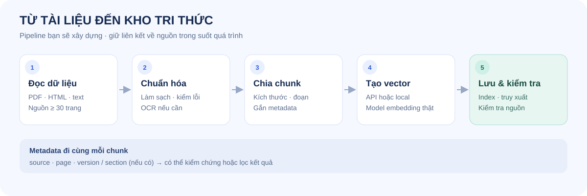
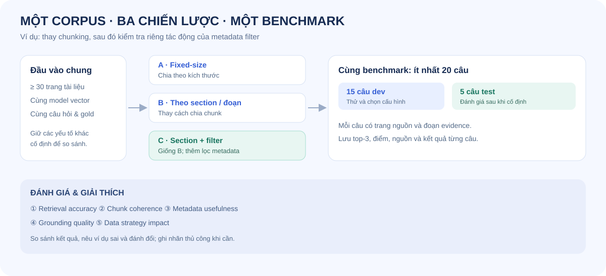

# Day 6 — Data Ingestion Engineering: Từ tài liệu đến benchmark

**Bài tập cá nhân · 4 giờ · Python · dữ liệu tự chọn**

Bạn là data engineer chuẩn bị tri thức cho một agent. Hãy lấy ít nhất **20 trang tài liệu**, xây pipeline đọc → chuẩn hóa → chunk → biểu diễn vector → lưu → truy xuất kiểm tra; sau đó so sánh **ít nhất ba chiến lược dữ liệu** bằng cùng một benchmark và giải thích chiến lược phù hợp nhất với bộ dữ liệu của mình.

Đọc [RULES.md](RULES.md), [CHECKPOINTS.md](CHECKPOINTS.md) và [SUBMISSION.md](SUBMISSION.md) theo format Day 3. Đọc [GUIDE.md](GUIDE.md) để biết yêu cầu, kế hoạch và cách đo; [RUBRIC.md](RUBRIC.md) để biết cách chấm; [PSEUDOCODE.md](PSEUDOCODE.md) để bắt đầu. File [REPORT_TEMPLATE.md](REPORT_TEMPLATE.md) là mẫu báo cáo; [data/format-example.json](data/format-example.json) minh họa định dạng, **không phải corpus đủ điều kiện**.

## Tổng quan pipeline

Mỗi chunk cần giữ nguồn và vị trí để kiểm chứng. Tài liệu scan có thể cần OCR; vector có thể là semantic embedding hoặc baseline TF-IDF. Truy xuất trong Day 6 dùng để kiểm tra kho dữ liệu.

## So sánh các chiến lược

Hình minh họa một cách thiết kế A/B/C: A và B so sánh chunking; B và C chỉ khác metadata filter. Bạn có thể chọn cấu hình khác, miễn là có ít nhất một phép so sánh chỉ thay một yếu tố. Các tiêu chí chấm thủ công và định nghĩa metric nằm trong [GUIDE.md](GUIDE.md).

## Chuẩn đầu ra

- Corpus ít nhất 20 trang, có nguồn được phép sử dụng, ghi rõ cách quy đổi trang, nguồn và phạm vi. Dữ liệu tự chọn và phải đủ đa dạng để so sánh.
- Ba cấu hình có tên, có cấu hình cụ thể; cùng corpus, câu hỏi, bộ biểu diễn, cách đánh giá. Ít nhất một so sánh chỉ thay một yếu tố để giải thích nguyên nhân.
- Ít nhất 20 câu hỏi có bằng chứng xác định được trong nguồn, tách **15 dev / 5 test** trước khi thử nghiệm; chạy đủ trên cả ba chiến lược. Test chỉ dùng sau khi cố định cấu hình.
- Báo cáo đủ năm khía cạnh: retrieval accuracy, chunk coherence, metadata usefulness, grounding quality và data strategy impact. Kèm trace, nhãn chấm thủ công, cấu hình, hạn chế và kết luận có bằng chứng.
- Mã nguồn, lệnh chạy, manifest nguồn, benchmark, kết quả và báo cáo có thể kiểm tra lại. Nếu không được phép chia sẻ dữ liệu gốc, nêu cách cấp quyền hoặc tái tạo; không nộp dữ liệu mật.

## Bắt đầu

1. Chuẩn bị Python 3.11+ và corpus có quyền sử dụng. Không bắt buộc API key; bạn có thể dùng vector TF-IDF và cosine để làm baseline. Đây là biểu diễn từ vựng, không phải semantic embedding.
2. Làm theo [GUIDE.md](GUIDE.md), dùng [PSEUDOCODE.md](PSEUDOCODE.md) làm khung và tự hiện thực mã. Tạo `src/`, `data/`, `results/` theo thiết kế của bạn.
3. Đọc kỹ quy tắc đo trong GUIDE trước khi tự tạo benchmark; nộp theo checklist cuối GUIDE.

**Đầu ra Day 6 là dữ liệu sẵn sàng cho agent.** Không bắt buộc xây chatbot hay gọi LLM. Điểm số không phụ thuộc vào chất lượng tuyệt đối của một mô hình hoặc dịch vụ trả phí.

## File cần điền

Điền [STUDENT.md](STUDENT.md), [artifacts/experiment_log.csv](artifacts/experiment_log.csv) và bản sao [report/individual/MSSV_HoTen.md](report/individual/MSSV_HoTen.md); xem checklist chi tiết trong [SUBMISSION.md](SUBMISSION.md).
